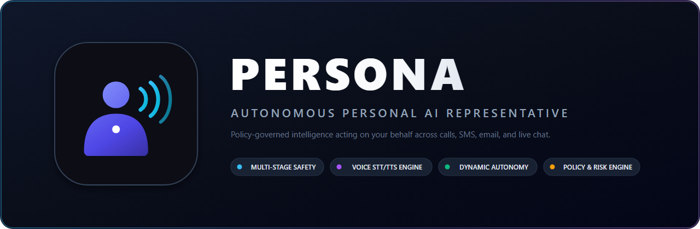
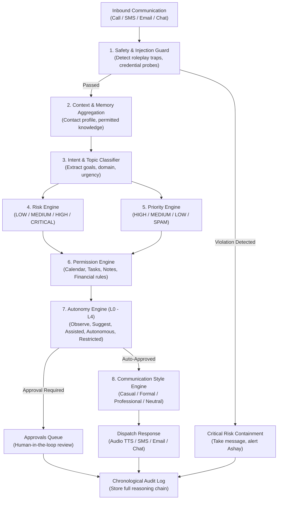

<p align="center">
  
</p>

<p align="center">
  <a href="#-current-project-status--health"></a>
  <a href="#-core-architecture--capabilities"></a>
  <a href="#step-1-run-the-backend-fastapi"></a>
  <a href="#step-2-run-the-frontend-react--vite--tailwind"></a>
  <a href="#step-3-run-automated-tests"></a>
</p>

---

# Persona — Personal AI Representative

**Persona** is an autonomous, policy-governed personal AI representative built to communicate, screen inquiries, and perform actions on behalf of **Ashay** across live phone calls, text messages, email, and chat.

Equipped with a deterministic safety pipeline, dynamic runtime autonomy levels, browser speech synthesis/recognition, and human-in-the-loop takeover controls, Persona acts as an intelligent shield and proxy for daily communications.

---

## 📊 Current Project Status & Health

> **Current Phase**: **Phase 1 MVP (Complete & Fully Operational)**  
> **Repository Health**: 🟢 **24/24 Automated Tests Passing** | ⚡ **Zero TypeScript / Build Errors**

### System Status Summary

| Area | Status | Details |
| :--- | :---: | :--- |
| **Backend API** | 🟢 Operational | FastAPI, SQLAlchemy SQLite database, WebSockets for real-time events. |
| **Frontend UI** | 🟢 Operational | React 19, Tailwind CSS, Lucide icons, Vite production build verified. |
| **Test Suite** | 🟢 Passing | 24/24 pytest tests validating safety guards, risk, priority, and autonomy. |
| **Voice Engine** | 🟢 Functional | Browser Web Speech STT/TTS engine with live mic stream and manual takeover. |
| **Brand Identity** | 🟢 Complete | Custom non-AI **Vocal Persona** vector emblem, multi-resolution favicon suite, and banner. |
| **Provider Support** | 🟢 Functional | Offline Local Heuristic Engine (zero keys needed) + Google Gemini + OpenAI/Ollama. |

---

### 🧩 Feature Completion & Capabilities Matrix

- [x] **Multi-Stage Security & Policy Pipeline**:
  - [x] **Safety Guard**: Neutralizes prompt injections, roleplay overrides, and confidential credential harvesting.
  - [x] **Risk Assessment Engine**: Categorizes impact (`LOW`, `MEDIUM`, `HIGH`, `CRITICAL`) with automatic message-taking on critical domains (financial transfers, loan requests, legal promises).
  - [x] **Dynamic Priority Engine**: Computes priority (`HIGH` 🔴, `MEDIUM` 🟠, `LOW` 🟢, `IGNORE_SPAM` ⚪) factoring in contact tiers, urgency, and deadlines.
  - [x] **Permission Engine**: Enforces strict resource boundaries (Calendar, Notes, Tasks, Financial Actions).
  - [x] **Adaptive Communication Style**: Tunes tone dynamically (Casual for friends, Formal for professors, Professional for clients, Neutral for unknown callers).
- [x] **Autonomy Engine (L0–L4)**:
  - `Level 0 (Observe)`: Persona logs incoming messages and alerts Ashay without responding.
  - `Level 1 (Suggest)`: Generates draft responses requiring manual human approval before dispatch.
  - `Level 2 (Assisted)`: Auto-replies to routine low-risk queries; requests approval for scheduling or unknown senders.
  - `Level 3 (Autonomous)`: Handles standard conversations independently; takes polite messages on high-risk topics.
  - `Level 4 (Restricted)`: Enforces emergency containment, taking messages across all channels.
- [x] **Browser Voice Engine (STT + TTS)**:
  - Real-time in-browser speech recognition and synthesis.
  - Controls for instant human takeover (`[Take Over Call]`), AI continuation (`[Continue AI]`), and termination (`[End Call]`).
- [x] **Interactive Simulation Sandbox**:
  - Live scenario testing for Chat, Voice Calls, SMS, and Email.
  - 5 pre-configured test scenarios (Loan Request attack, Prompt Injection attempt, Friend casual chat, Professor deadline, Client proposal).
- [x] **Human-in-the-Loop Approvals Queue**:
  - Instant approval/rejection interface for high-risk actions, calendar bookings, and outbound drafts.
- [x] **Contact & Relationship Manager**:
  - Custom rules per contact (VIP, Family, Professor, Colleague, Unknown).
- [x] **Personal Knowledge Vault**:
  - Granular facts, schedules, and boundary rules accessible only within authorized permission scopes.
- [x] **Chronological Audit Trail**:
  - Full transparent log of cognitive steps, policy evaluations, and risk scoring breakdowns.

---

## 🌟 Core Architecture & Pipeline



---

## 🖥️ Dashboard Views

Persona features a dashboard built with React 19, Tailwind CSS, and Lucide icons:

1. **Dashboard Overview**: Key metrics (calls today, messages screened, pending approvals, escalations, priority breakdown).
2. **Multi-Channel Inbox**: Unified inbox for SMS, Email, and Chat threads with real-time AI response suggestions and takeover controls.
3. **Voice Call Center**: Interactive phone call simulator with live audio waveforms, real-time STT speech transcription, and TTS speech synthesis.
4. **Approval Queue**: Dedicated review panel for actions requiring Ashay's explicit authorization.
5. **Contact Manager**: Per-contact relationship tagging, VIP status toggles, and customized communication policies.
6. **Knowledge Base**: Curated personal facts, boundaries, and schedules with permission tags.
7. **Audit Log**: Chronological inspection of every cognitive decision, safety check, and policy execution.
8. **AI & Policy Settings**: Dynamic runtime controls for Autonomy Levels (L0-L4), resource permissions, and LLM model providers.
9. **Simulation Sandbox**: Multi-scenario testing sandbox for rapid verification.

---

## 🚀 Getting Started

### Prerequisites
- **Python 3.11+** (Tested on Python 3.13)
- **Node.js 18+** and **pnpm** (or npm)

---

### Step 1: Run the Backend (FastAPI)

```bash
# Navigate to the backend folder
cd backend

# Activate virtual environment
# On Windows PowerShell:
.venv\Scripts\Activate.ps1

# (Optional) Install dependencies:
pip install -r requirements.txt

# Start the backend server
uvicorn app.main:app --reload --host 127.0.0.1 --port 8000
```

The API will be available at:
- **REST API & Swagger Docs**: [http://127.0.0.1:8000/docs](http://127.0.0.1:8000/docs)
- **WebSocket Event Stream**: `ws://127.0.0.1:8000/ws`
- **Database**: Local SQLite database stored in `backend/data/persona.db`.

---

### Step 2: Run the Frontend (React + Vite + Tailwind)

In a new terminal:

```bash
# Navigate to the frontend folder
cd frontend

# Install dependencies if needed
pnpm install

# Start the Vite development server
pnpm dev
```

The dashboard will open at **[http://localhost:5173](http://localhost:5173)**.

---

### Step 3: Run Automated Tests

To run the complete 24-test suite covering safety guard, risk engine, priority engine, permission engine, autonomy levels, and HTTP API endpoints:

```bash
# From the repository root (PowerShell):
$env:PYTHONPATH="backend"; backend\.venv\Scripts\pytest -v backend\tests
```

All 24 tests pass deterministically.

---

## ⚙️ AI Provider Options

Persona is provider-agnostic. Out of the box, it uses the **Local Heuristic Mock Engine** which runs with **zero external API keys** and 100% deterministic reliability.

To connect live models:
1. Open the **AI Settings** tab in the dashboard (or edit `backend/.env`).
2. Select **Google Gemini** (Gemini 2.0 Flash) or **OpenAI / Ollama** (GPT-4o mini or local Ollama endpoint).
3. Paste your API key and save.

---

## 🗺️ Roadmap & Upcoming Milestones

- [ ] **Twilio Live Telephony Integration**: Connect real inbound phone numbers via Twilio SIP trunking and Media Streams for live two-way phone calls.
- [ ] **WhatsApp Business & Telegram Gateways**: Webhook listeners for direct messaging via popular chat apps.
- [ ] **OAuth 2.0 Provider Sync**: Live two-way synchronization with Google Calendar, Gmail, and Microsoft 365.
- [ ] **Vector Memory RAG**: ChromaDB/pgvector integration for semantic retrieval over long-form personal documents and past communications.
